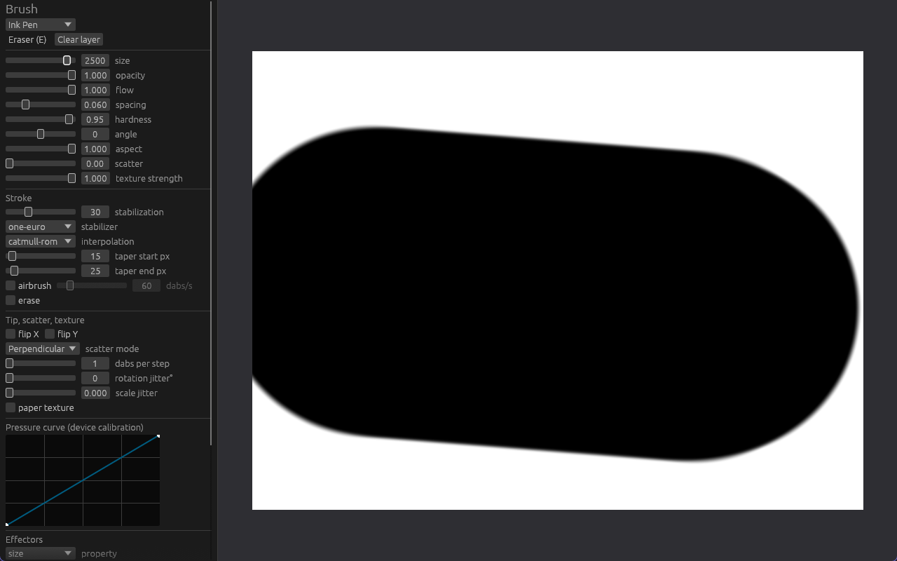

# Mirae

A professional raster illustration editor written from scratch in Rust
(wgpu + winit), with a deterministic, tested brush engine. Developed
clean-room: behaviour may be studied from the outside, the implementation
is original ([docs/CLEAN_ROOM.md](docs/CLEAN_ROOM.md)).

**Status:** phases 1–4 complete (canvas, tablet input, brush engine,
architecture audit, and layers and document: layer stack, undo/redo,
blend modes, masks, clipping, alpha lock, 16-bit storage, `.mirae`
files and PNG, integration). Phase 5 (editing fundamentals) is under way:
5A (colour), 5B (layer workflow), 5C (selections), 5D (transform), 5E
(fill) and 5F (gradients) are complete; nothing after them is started. 618 tests
passing. Windows is the
primary platform (Windows Ink); no physical tablet has been validated yet.
Details: [docs/STATUS.md](docs/STATUS.md).



## Quick start

Requires Rust ≥ 1.95 (rustup, MSVC toolchain on Windows).

```sh
cargo run --release -p tela-app          # the editor (binary: tela)
cargo test --workspace --release         # all tests, including golden images
powershell -ExecutionPolicy Bypass -File scripts\check.ps1   # full local gate
```

## Controls

Pen (Windows Ink: pressure, tilt, rotation, eraser end) and mouse share one
input path; the pen works on the panels too. The window is laid out around
the canvas (docs/architecture/ui.md):

- **Top bar**: the document's name (an orange dot while it has unsaved
  changes), New (8- or 16-bit), Open, Save, Save As, Import PNG (a new
  centred layer), Export PNG, Undo, Redo. Documents are `.mirae` files
  (docs/formats/mirae-v1.md); dropping a `.mirae` on the window opens it,
  a `.png` imports it. Before anything replaces or closes a modified
  document, Mirae asks Save / Don't Save / Cancel.
- **Tool strip** (left): Brush, Eraser, Eyedropper, Select, Move, Fill,
  Gradient, Transform; the active tool is filled in blue.
- **Tool options** (beside it, scrolling): the colour section — main and
  sub colour (the framed one paints), HSV square and hue bar, RGB, HSV,
  hex, where the eyedropper picks (canvas or layer), recent colours,
  swatches (click to use, right-click to remove, + to add) — then only the
  active tool's options: the brush's preset and parameters (stroke,
  tip/scatter/texture, pressure curve and effectors fold away); the
  selection's shape, mode, anti-aliasing, All/None/Invert and feather;
  the bucket's Draw/Erase mode, reference (layer or visible canvas),
  tolerance, anti-aliasing and Fill layer/selection; the gradient's
  Draw/Erase mode, presets, shape, ends, mixing, dithering and stops (a
  bar with draggable markers, colour from main, sub or fixed, opacity,
  position); the transform's flips, size, angle, resampling and Apply /
  Cancel. Colours and tool settings are session state: not saved in
  documents, not part of undo.
- **Right panel**: the Document section (size, depth with conversion,
  export options: transparent, 16-bit) and the layers: New, Delete,
  Up/Down, Merge down, Clear; blend mode, opacity, clipping, lock
  transparent pixels, the mask (add, on/off, delete; which part tools
  edit, shown in orange while it is the mask); rows to select, hide, lock,
  rename (double-click) and reorder (drag).

A selection limits every stroke, fill and gradient until it is removed;
it is shown with marching ants, is part of undo and is not saved. A
transform shows a box with handles: drag inside to move, outside or the
round handle to rotate, a corner or a side to scale (Keep aspect, or
Shift), the centre cross to move the pivot; Enter or Apply commits one
undo step, Escape or Cancel discards it. Gradients preview live; Shift
snaps to 45°, Escape cancels.

| Input | Action |
|---|---|
| Left drag / pen | Paint (pen eraser end erases); picks the colour when the eyedropper is on; draws a selection with the selection tool; fills with the fill tool; draws a gradient with the gradient tool |
| M / B | Selection tool / brush (B also leaves eraser mode) |
| Shift, Alt, Shift+Alt at the press (selection tool) | Add, subtract, intersect; Shift during the drag: square |
| Ctrl+A, Ctrl+D, Ctrl+Shift+I | Select all, deselect, invert the selection |
| Esc | Cancel the selection being drawn; discard a transform |
| Ctrl+T, Enter | Transform the layer (or the selection); apply it |
| K | Move tool (drag moves the layer or the selection) |
| G | Gradient tool, then fill tool (G cycles them): a drag draws a gradient; a click with the bucket fills the connected area under it |
| Alt+Delete | Fill the selection, or the whole layer without one (erase it in the fill tool's Erase mode) |
| Ctrl+Z, Ctrl+Y during a transform | Undo, redo its last edit |
| Right-click, or Alt + click / pen (not with the selection tool) | Pick the colour shown under the cursor |
| X | Paint with the other colour (main ↔ sub) |
| D | Main colour black, sub white |
| 1–8 | Presets: ink pen, pencil, soft round, marker, airbrush, chalk, calligraphy, eraser |
| E | Toggle the brush's eraser (gradient and fill have their own Draw / Erase mode) |
| Middle drag, or Space + drag | Pan |
| Wheel | Zoom at cursor |
| Shift + wheel | Rotate 15° at cursor |
| `[` / `]` | Brush size |
| `-` / `=` | Stabilization −/+ 10 (0–100) |
| S | Cycle stabilizer (none, moving average, exponential, One Euro) |
| I | Cycle interpolation (linear, Catmull–Rom, Bézier) |
| T | Toggle start/end tapers |
| O | Toggle pressure → opacity |
| C | Clear the active layer's pixels |
| Ctrl+N | New document (8-bit, same size) |
| Ctrl+O | Open a document |
| Ctrl+S | Save |
| Ctrl+Shift+S, Shift+Alt+S | Save As |
| Ctrl+Shift+N | New layer above the active one |
| Ctrl+E | Merge the active layer into the one below |
| Ctrl+Z | Undo |
| Ctrl+Y, Ctrl+Shift+Z | Redo |
| F3 | Latency summary in the title bar |
| Home | Fit document |

Without tablet hardware, `inject_pen` drives the running app with a
synthetic Windows Ink pen (see [docs/testing.md](docs/testing.md#hardware-tests)).

## Architecture

```
tablet (input, FFI) ──► app ──► brush (presets, dynamics, pipeline, dabs, stroke buffer)
                         │ ──► document (layers, per-tile composition; stroke as overlay)
                         │ ──► renderer (wgpu display texture)  ◄── ui (egui overlay)
                         │ ──► io (.mirae files, PNG) ──► document
color, canvas: shared foundations          corpus: goldens + benchmarks
```

The app owns all state. The brush engine never sees the document; the
renderer never sees the document; the UI owns nothing. Boundaries are
enforced by a test. Read [docs/architecture/ARCHITECTURE.md](docs/architecture/ARCHITECTURE.md).

| Crate | Responsibility |
|---|---|
| `tela-color` | The paint colour (`Color`, HSV, hex), straight/premultiplied RGBA, Porter-Duff over, 8/16-bit storage formats, sRGB |
| `tela-canvas` | Sparse 256×256 tiles, dirty sets, view transform |
| `tela-brush` | Presets (versioned JSON), effectors, stabilizers, interpolation, spacing, tips, textures, scatter, airbrush, stroke buffer |
| `tela-document` | Layer stack, masks, clipping, blend modes, 8/16-bit storage, undo/redo, per-tile composition, selections, transforms, fill, gradients |
| `tela-io` | `.mirae` documents (save atomically, load hostile input safely), PNG import/export |
| `tela-renderer` | wgpu presentation: mipmapped display texture, overlay hook |
| `tela-tablet` | Input samples, Windows Ink backend, input clock |
| `tela-ui` | egui panels (colour, selection, fill, gradient, transform, brush, layers, document, history), curve editor, prompts |
| `tela-corpus` | Golden brush sheets, image diff, stamping benchmark |
| `tela-app` | Window, event loop, wiring (binary `tela`) |

## Tests

574 tests: unit, integration, property (`proptest`), golden images of every
built-in preset, GPU display tests (skipped without a GPU) and crate
boundary checks, file-format corruption and compatibility tests, parity
tests against data measured in the reference, and end-to-end sessions
(scenarios, randomized sessions, stress). Benchmarks are separate
examples (`scripts\check.ps1 -Bench` runs the gating ones). See
[docs/testing.md](docs/testing.md) and [docs/golden-tests.md](docs/golden-tests.md).

## Documentation

| Document | Purpose |
|---|---|
| [docs/AI_HANDOFF.md](docs/AI_HANDOFF.md) | Start here when continuing the project |
| [docs/architecture/](docs/architecture/ARCHITECTURE.md) | Architecture, crate graph, invariants, concurrency, unsafe, errors, UI |
| [docs/adr/](docs/adr/README.md) | Architecture decision records |
| [docs/formats/mirae-v1.md](docs/formats/mirae-v1.md) | The `.mirae` document format |
| [docs/PARITY.md](docs/PARITY.md) | Parity with the reference, per subsystem |
| [docs/performance.md](docs/performance.md), [docs/memory.md](docs/memory.md) | Hot paths and current numbers; memory model |
| [docs/STATUS.md](docs/STATUS.md), [docs/ROADMAP.md](docs/ROADMAP.md), [docs/TECHNICAL_DEBT.md](docs/TECHNICAL_DEBT.md) | Where the project stands and goes |
| [docs/phase5/PLAN.md](docs/phase5/PLAN.md) | Phase 5 plan: 5A–5F done, the rest proposed |
| [CONTRIBUTING.md](CONTRIBUTING.md), [AGENTS.md](AGENTS.md), [CHANGELOG.md](CHANGELOG.md) | How to work on it; history |
| [docs/phase2/](docs/phase2/README.md), [docs/phase3/](docs/phase3/README.md), [docs/phase4/](docs/phase4/README.md) | Phase reports with evidence |

## Roadmap

- [x] Phase 1 — window, wgpu, tiled canvas, mouse drawing, pan/zoom/rotate
- [x] Phase 2 — Windows Ink input, pressure, interpolation, stabilization ([report](docs/phase2/README.md))
- [x] Phase 3 — brush presets, effectors, tips, textures, airbrush, eraser ([report](docs/phase3/README.md))
- [x] Phase 3.5 — architecture audit, boundaries, documentation, handoff
- [x] Phase 4 — layers, blend modes, undo/redo, masks, 16-bit storage, document I/O, integration ([report](docs/phase4/README.md))
- [ ] Phase 5 — editing fundamentals: [x] 5A colour; [x] 5B layer workflow; [x] 5C selections; [x] 5D transform; [x] 5E fill; [x] 5F gradients; proposed: integration ([plan](docs/phase5/PLAN.md))
- [ ] Later — layer folders, vector layers, rulers/symmetry/perspective, advanced brushes, comic tools, colour management ([roadmap](docs/ROADMAP.md))

## Clean-room notice

No decompiled code, third-party assembly, decompiler pseudocode, extracted
code, proprietary assets/icons/shaders/presets, or undocumented proprietary
formats are used as a basis for implementation. Algorithms come from public
mathematics and literature (e.g. Porter–Duff 1984, Fritsch–Carlson 1980,
Casiez et al. 2012, Yuksel et al. 2011) and this project's own measured
requirements. All brush tips and paper textures are generated by code.

License: MIT OR Apache-2.0 (workspace metadata).
