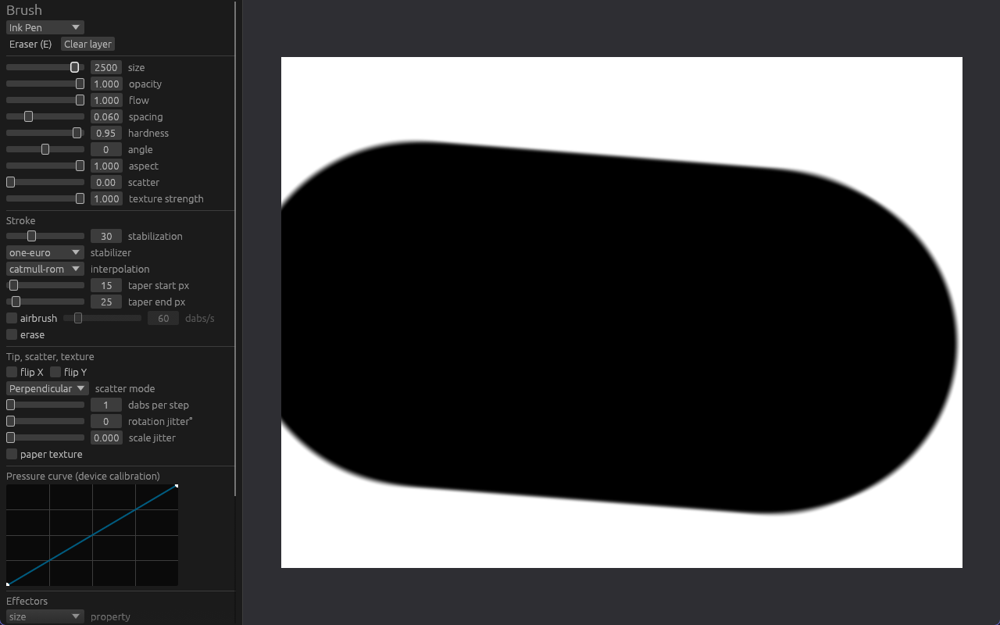

# Tela

A professional raster illustration editor written from scratch in Rust
(wgpu + winit), with a deterministic, tested brush engine. Developed
clean-room: behaviour may be studied from the outside, the implementation
is original ([docs/CLEAN_ROOM.md](docs/CLEAN_ROOM.md)).

**Status:** phases 1–3 complete (canvas, tablet input, brush engine);
phase 3.5 (architecture audit and handoff) complete; phase 4 (layers, undo,
blend modes, I/O) planned, not started. 206 tests passing. Windows is the
primary platform (Windows Ink); no physical tablet has been validated yet.
Details: [docs/STATUS.md](docs/STATUS.md).



## Quick start

Requires Rust ≥ 1.95 (rustup, MSVC toolchain on Windows).

```sh
cargo run --release -p tela-app          # the editor (binary: tela)
cargo test --workspace --release         # all tests, including golden images
powershell -ExecutionPolicy Bypass -File scripts\check.ps1   # full local gate
```

## Controls

Pen (Windows Ink: pressure, tilt, rotation, eraser end) and mouse share one
input path. The panel on the left edits the active preset, its effectors
and the pressure curve; the pen works on the panel too.

| Input | Action |
|---|---|
| Left drag / pen | Paint (pen eraser end erases) |
| 1–8 | Presets: ink pen, pencil, soft round, marker, airbrush, chalk, calligraphy, eraser |
| E | Toggle eraser mode |
| Middle drag, or Space + drag | Pan |
| Wheel | Zoom at cursor |
| Shift + wheel | Rotate 15° at cursor |
| `[` / `]` | Brush size |
| `-` / `=` | Stabilization −/+ 10 (0–100) |
| S | Cycle stabilizer (none, moving average, exponential, One Euro) |
| I | Cycle interpolation (linear, Catmull–Rom, Bézier) |
| T | Toggle start/end tapers |
| O | Toggle pressure → opacity |
| C | Clear layer |
| F3 | Latency summary in the title bar |
| Home | Fit document |

Without tablet hardware, `inject_pen` drives the running app with a
synthetic Windows Ink pen (see [docs/testing.md](docs/testing.md#hardware-tests)).

## Architecture

```
tablet (input, FFI) ──► app ──► brush (presets, dynamics, pipeline, dabs, stroke buffer)
                         │ ──► document (layers, per-tile composition; stroke as overlay)
                         │ ──► renderer (wgpu display texture)  ◄── ui (egui overlay)
color, canvas: shared foundations          corpus: goldens + benchmarks
```

The app owns all state. The brush engine never sees the document; the
renderer never sees the document; the UI owns nothing. Boundaries are
enforced by a test. Read [docs/architecture/ARCHITECTURE.md](docs/architecture/ARCHITECTURE.md).

| Crate | Responsibility |
|---|---|
| `tela-color` | Straight/premultiplied RGBA, Porter-Duff over, sRGB |
| `tela-canvas` | Sparse 256×256 tiles, dirty sets, view transform |
| `tela-brush` | Presets (versioned JSON), effectors, stabilizers, interpolation, spacing, tips, textures, scatter, airbrush, stroke buffer |
| `tela-document` | Raster layers and per-tile composition |
| `tela-renderer` | wgpu presentation: mipmapped display texture, overlay hook |
| `tela-tablet` | Input samples, Windows Ink backend, input clock |
| `tela-ui` | egui brush panel and curve editor |
| `tela-corpus` | Golden brush sheets, image diff, stamping benchmark |
| `tela-app` | Window, event loop, wiring (binary `tela`) |

## Tests

206 tests: unit, integration, property (`proptest`), golden images of every
built-in preset, GPU display tests (skipped without a GPU) and crate
boundary checks. Benchmarks are separate examples. See
[docs/testing.md](docs/testing.md) and [docs/golden-tests.md](docs/golden-tests.md).

## Documentation

| Document | Purpose |
|---|---|
| [docs/AI_HANDOFF.md](docs/AI_HANDOFF.md) | Start here when continuing the project |
| [docs/architecture/](docs/architecture/ARCHITECTURE.md) | Architecture, crate graph, invariants, concurrency, unsafe, errors, UI |
| [docs/adr/](docs/adr/README.md) | Architecture decision records |
| [docs/performance.md](docs/performance.md) | Hot paths and current numbers |
| [docs/STATUS.md](docs/STATUS.md), [docs/ROADMAP.md](docs/ROADMAP.md), [docs/TECHNICAL_DEBT.md](docs/TECHNICAL_DEBT.md) | Where the project stands and goes |
| [CONTRIBUTING.md](CONTRIBUTING.md), [AGENTS.md](AGENTS.md), [CHANGELOG.md](CHANGELOG.md) | How to work on it; history |
| [docs/phase2/](docs/phase2/README.md), [docs/phase3/](docs/phase3/README.md) | Phase reports with evidence |

## Roadmap

- [x] Phase 1 — window, wgpu, tiled canvas, mouse drawing, pan/zoom/rotate
- [x] Phase 2 — Windows Ink input, pressure, interpolation, stabilization ([report](docs/phase2/README.md))
- [x] Phase 3 — brush presets, effectors, tips, textures, airbrush, eraser ([report](docs/phase3/README.md))
- [x] Phase 3.5 — architecture audit, boundaries, documentation, handoff
- [ ] Phase 4 — layers, blend modes, undo/redo, masks, 16-bit storage, document I/O
- [ ] Phase 5 — vector layers and editing
- [ ] Phase 6 — selections, transform, fill, gradients
- [ ] Phase 7 — rulers, symmetry, perspective
- [ ] Phase 8 — wet media, color mixing, advanced brushes

## Clean-room notice

No decompiled code, third-party assembly, decompiler pseudocode, extracted
code, proprietary assets/icons/shaders/presets, or undocumented proprietary
formats are used as a basis for implementation. Algorithms come from public
mathematics and literature (e.g. Porter–Duff 1984, Fritsch–Carlson 1980,
Casiez et al. 2012, Yuksel et al. 2011) and this project's own measured
requirements. All brush tips and paper textures are generated by code.

License: MIT OR Apache-2.0 (workspace metadata).
