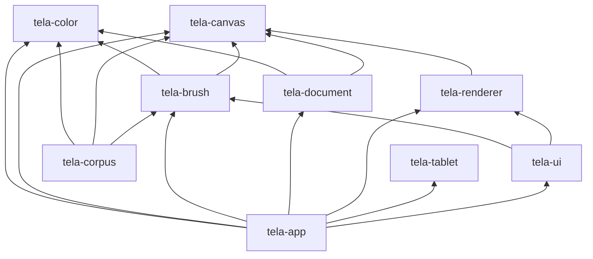

# Crate dependencies

The workspace is split into crates so that architectural boundaries are
enforced by the compiler, not by convention. This page is the source of
truth for which dependencies are allowed. It is **enforced** by
`crates/app/tests/crate_boundaries.rs`: each crate's normal dependencies must
equal the allowed set below, so adding or removing one fails the test until
this page and the test table are updated together.

## Graph (normal dependencies, workspace crates only)



ASCII version (each line: crate -> what it may use):

```
layer 3   app       -> ui, document, renderer, tablet, brush, canvas, color
layer 2   ui        -> brush, renderer
          corpus    -> brush, canvas, color            (test support only)
layer 1   brush     -> canvas, color
          document  -> canvas, color
          renderer  -> canvas
          tablet    -> (none)                          (FFI, Windows Ink)
layer 0   canvas    -> (none)
          color     -> (none)
```

A crate may only use crates in lower layers, and not every lower crate.
`tela-tablet` and `tela-color` have no workspace dependencies; `tela-canvas`
depends only on `glam`.

## Allowed dependencies

| Crate | Allowed normal dependencies | Why |
|---|---|---|
| `tela-color` | — | Pure math; everything else builds on it. |
| `tela-canvas` | `glam` | Tiles, rectangles, view transform. |
| `tela-brush` | color, canvas, `glam`, `serde`, `serde_json`, `rayon` | Engine; JSON presets; per-tile parallel stamping. |
| `tela-document` | color, canvas | Layers and composition; brush-agnostic. |
| `tela-renderer` | canvas, `wgpu`, `glam`, `bytemuck`, `log` | GPU presentation of finished tiles. |
| `tela-tablet` | `glam`, `log`; Windows: `windows-sys`, `raw-window-handle` | Device input; FFI isolated here. |
| `tela-ui` | brush, renderer, `egui`, `egui-wgpu`, `egui-winit`, `wgpu`, `winit` | The only egui user. |
| `tela-corpus` | color, canvas, brush, `glam`, `png` (dev: document) | Golden sheets and benchmark. |
| `tela-app` | all workspace crates except corpus, `winit`, `glam`, `pollster`, `log`, `env_logger` | Composition layer. |

Dev-dependencies are unrestricted but should stay minimal: `proptest`
(brush, canvas), `pollster` (renderer GPU tests), `tela-brush`+`glam`
(document tests), `tela-document` (corpus benchmark).

## Forbidden dependencies (and why)

| Rule | Reason |
|---|---|
| `brush` must not depend on `tablet`, `winit`, `windows-sys` | The engine must run headless, in tests and on any platform; device specifics end at `TabletSample`. |
| `brush` must not depend on `document` | The engine produces a stroke mask; committing it is the app's decision (undo, layers, selection later). |
| `renderer` must not depend on `document` or `brush` | It draws finished tiles; it can never read or mutate document state. |
| `document` must not depend on `brush` or `renderer` | The model must not know how pixels were produced or shown; the stroke preview enters through the `Overlay` callbacks. |
| Only `ui` depends on `egui*` | Swapping or removing the UI toolkit touches one crate. |
| Only `app` and `ui` depend on `winit` | Core crates know no windowing; `ui` needs winit only to feed egui. |
| Only `tablet` depends on `windows-sys` | `unsafe` FFI stays in one crate (docs/architecture/unsafe.md). |
| Nothing depends on `app` or `corpus` | `app` is the top; `corpus` is test support. |

## External dependencies

| Dependency | Used by | Why it exists |
|---|---|---|
| `glam` | canvas, brush, renderer, tablet, ui (via egui), app | Small SIMD vector math (`Vec2`, `Affine2`). |
| `serde`, `serde_json` | brush | Versioned JSON presets with lenient loading. |
| `rayon` | brush | Work-stealing pool for per-tile parallel stamping. |
| `wgpu` | renderer, ui | Portable GPU API (Vulkan/DX12/Metal). |
| `bytemuck` | renderer | Safe casts of uniform structs to bytes. |
| `winit` | app, ui | Window and event loop. |
| `egui`, `egui-wgpu`, `egui-winit` | ui | Immediate-mode UI; isolated in one crate. |
| `windows-sys` | tablet | Windows Ink (WM_POINTER) and QPC FFI bindings. |
| `raw-window-handle` | tablet | Takes the window by safe handle, not raw HWND. |
| `pollster` | app (+ renderer tests) | Blocks on wgpu's async setup once at startup. |
| `log`, `env_logger` | renderer, tablet, app | Diagnostics (`RUST_LOG`). |
| `png` | corpus | Golden image I/O. |
| `proptest` | brush, canvas (dev) | Property tests. |

Rule: do not add a dependency for convenience. A new dependency needs a
row here, a reason, and the boundary test updated in the same commit.
