# UI and E2E audit — phase 5F quality gate

Date: 2026-10-17. Branch `fix/ux-e2e-quality-gate` (from `main` at
`3070c18`). Machine: Windows 11 Pro, Ryzen 7 5800X, Radeon RX 7700 XT
(Vulkan), one 2560×1440 display at 100 % scaling. Input: mouse and
keyboard through `SendInput`, the synthetic Windows Ink pen; **no
physical tablet**.

The owner revoked the approval of phase 5F for functional problems with
gradients and serious interface problems. This audit reproduced them in
the running application, found their causes, fixed the P0/P1/P2 ones and
left a desktop E2E suite that would have caught them
([QUALITY_GATE.md](QUALITY_GATE.md), [E2E_MATRIX.md](E2E_MATRIX.md)). It
does not approve anything: **the owner's own test of Mirae decides.**

## Method

1. The release build of `main`, opened by hand and driven from
   PowerShell (screen captures at 1280×800 and maximized).
2. A test mode in the executable (`TELA_E2E_DIR`, off in production)
   that publishes the app's state and egui's description of every widget,
   and the `tela-e2e` driver that operates the real window with OS input
   ([testing.md](../testing.md#desktop-end-to-end-tests), ADR 0028).
3. Each suspected defect reproduced with a failing E2E test (or, for
   behaviour of `main` itself, with the `main` build by hand), its cause
   found in the code, fixed, the test passing.

## Defects

Severity as in [QUALITY_GATE.md](QUALITY_GATE.md#required-for-a-subphase).
"Origin" says whether `main` had it.

| ID | Sev. | Defect | Origin | Cause | Fix (commit) | Regression test |
|---|---|---|---|---|---|---|
| Q-01 | P1 | At the default 1280×800 window (and smaller), the left panel stacked colour, selection, fill, gradient, transform and brush controls without a way to scroll: brush presets, eraser, brush size, Transform/Move/Flip and the gradient's Add stop / Remove / Reverse were below the window, unreachable. | `main` | Six panels in one fixed side panel; only the brush part had a scroll area, which ended below the window. | Redesign: tool strip + contextual, scrolling tool options ([below](#interface-redesign), `6117fab`) | `ui_layout.rs` `essential_controls_are_reachable_at_reference_sizes` (failed before with 14 unreachable controls) |
| Q-02 | P1 | Gradient preview lagging and partial: on the default 4000×3000 document a whole-canvas preview took 246–797 ms to catch up after the pointer stopped, and while the pointer moved the last tiles in a fixed order were never refreshed, showing a previous gradient (screenshots below). | `main` | Tiles composed one by one on the UI thread within 12 ms per frame, always from the same end of the list: every pointer move restarted the list, starving the far tiles. | Tiles composed on scoped threads (bit-identical, GR5 kept), on-screen first then least recently composed (`afc51d4`) | `gradient.rs` `every_shape_and_end_…` (preview within 1.5 s, correct on screen at 36 points); `performance.rs` (measured 105–170 ms) |
| Q-03 | P1 | Ghost gradient: losing the focus during a gradient drag (Alt+Tab, a notification, a dialog) left the preview and its guide on the canvas, never applied (title unmodified, Undo disabled). | `main` | `Focused(false)` reset the drag state but not the gradient session, so the preview kept being composed. | The session is cancelled, as Escape does; a pick drag ends too (`afc51d4`) | `gradient.rs` `losing_the_focus_during_a_drag_leaves_no_ghost_preview` (failed before) |
| Q-04 | P1 | A click on a panel button right after the window moved (or any move-then-click faster than a frame) reached the canvas and painted a stroke. | Latent in `main`, exposed by fixing Q-06 | Whether a press belongs to the UI was asked of egui with the previous frame's pointer; `main` redrew continuously, so the window was a few ms wide. | The panels' areas under the current pointer decide too (`afc51d4`) | `ui_layout.rs` `a_click_on_a_panel_right_after_the_window_moved_never_paints`; the size gate checks no browsing creates a step |
| Q-05 | P1 | The brush's eraser mode silently carried over to the gradient and the bucket: after E (or the Eraser button) then G, a gradient on an empty layer showed and committed nothing, and on a drawn layer it **erased the drawing**, while the panel still read "Main to Sub"; Alt+Delete erased instead of filling. The likeliest source of "the gradient is broken". | `main` (reproduced by hand: E, G, a drag wiped two strokes) | One `eraser_mode` flag shared by brush, gradient and fill, shown only on the brush. | Gradient and fill have their own Mode (Draw / Erase), Draw by default, Erase shown in orange (`3187acb`) | `gradient.rs` `the_eraser_does_not_turn_gradients_and_fills_into_erasers` |
| Q-06 | P2 | The app redrew continuously while idle (140–170 frames per second, 15–16 % of a core: 0.47 CPU-seconds in 3 s on `main`). | `main` | Every redraw event was passed to egui-winit, which answers "repaint" to it, and the app then requested the next redraw. | Redraw events no longer request one (`afc51d4`) | `performance.rs` (idle frames, idle CPU: 0–3 frames and ≤ 1 % now) |
| Q-07 | P2 | B after E kept erasing (the title still said "Eraser"). | `main` | B selected the brush tool but left eraser mode on. | B leaves eraser mode (`afc51d4`) | `ui_layout.rs` `the_active_tool_is_marked_in_the_interface` |
| Q-08 | P2 | Layout shifts: the first stroke moved the whole left panel up 9 px (the empty "Recent" hint became a swatch row); the modified marker widened the document name and moved the top bar. | `main` (first); redesign (second, caught before commit) | Rows sized by their content. | Fixed-height recent row; fixed-width name with a separate marker (`6117fab`) | `ui_layout.rs` `the_layout_does_not_move_when_the_state_changes` |
| Q-09 | P2 | Maximizing or resizing left the canvas where it was (top-left of a larger window). | `main` | Resizes kept the view's pan. | The canvas keeps its place in the middle of the free area; Home fits it below the top bar too (`6117fab`) | `paint_color_layers.rs` (Home shows the whole document); screenshots |
| Q-10 | P2 | Ambiguous and inconsistent controls: two "Linear" (shape and mixing), two "Ellipse", two "None", "Sub"/"Int" abbreviations, the active tool marked differently in each panel (a "Brush" button inside Selection, "Tool" in Gradient, "Bucket" in Fill), stop colour "Set". | `main` | No shared vocabulary or layout. | One tool strip; labelled rows; "Linear light", "Subtract", "Intersect", "Fixed" (`6117fab`) | `ui_layout.rs` (selectors are unambiguous; one marked tool) |
| Q-11 | P2 | At 800×600 the top bar's size label overlapped Undo and Redo was cut. | Redesign (caught by the gate before commit) | Right-aligned label in a full bar. | Size moved to the Document section (`6117fab`) | `ui_layout.rs` overlap check (labels included) |
| Q-12 | P3 | The gradient bar cut the markers of the first and last stop in half. | `main` | Markers centred on the bar's ends. | Bar inset by half a marker (`6117fab`) | screenshot |
| Q-13 | P3 | The export "transparent" tooltip said blend layers could not be exported, which 5B had fixed. | `main` | Stale text. | Updated (`6117fab`) | — |

### Open (not fixed; listed for the owner)

| ID | Sev. | Item | Why open | Where tracked |
|---|---|---|---|---|
| Q-14 | P2 | Committing a gradient (or a fill) over a whole 4000×3000 canvas blocks the window ~0.32 s with no busy feedback. | The commit runs in `tela-document`, which has no threads (crate boundary); the preview is fast now. | TECHNICAL_DEBT #43 |
| Q-15 | P3 | One fast wheel event of several notches with Shift rotates 15° once (zoom honours the notch count). | Cosmetic; changing the step needs a decision on rotation steps. | TECHNICAL_DEBT #44 |
| Q-16 | P3 | egui counts clicks less than 0.3 s apart as one series wherever they land: a click on New then a double-click on a row within 0.3 s does not rename. | egui behaviour; a person rarely does this. | TECHNICAL_DEBT #44 |
| Q-17 | P3 | Clear (and C) clears the layer's pixels even while the mask is the edit target. | The reference's behaviour (clearing a mask) is not observed; the button's tooltip now says what it does. | PARITY D-AUD-1 |
| Q-18 | — | New documents are always 4000×3000 (no size choice). | A missing feature, not a defect; no new features in this work. | ROADMAP |

### Checked and not reproduced (section 5 of the brief)

Each was looked for with the E2E suite (gradient.rs, scenarios.rs) and by
hand; none was found **in the cases tested**:

| Suspected problem | What was checked | Result |
|---|---|---|
| Preview does not appear | 9 shape × end combinations, 16-bit, rotated view: the screen equals the oracle at 36 points while the button is held | Appears (Q-02 was lag, Q-05 the eraser mode) |
| Wrong position, inverted axis, geometry unlike the drag | Committed pixels equal the engine applied to the dragged geometry (≤ 2 levels) at 36 points, at fit zoom and zoomed + rotated 30° + panned | Correct |
| A stop change does not update / settings without effect / UI and engine out of sync | Hex, Fixed, add, reverse, remove, shape, ends, mixing read back from the app's state and compared in pixels | Correct |
| Applied result differs from the preview | Preview on screen and committed document both equal the oracle | Equal (GR5) |
| Keyboard focus intercepting commands | Hex, size, opacity and RGB fields: a canvas click or Escape returns the keyboard; shortcuts act | Not reproduced (the 5C note D-5C-7 no longer applies) |
| Changing tool loses state | Gradient settings and stops persist across tool switches (long session, 6 rounds) | Kept |
| Partial results, stale tiles, cache not invalidated | Screen vs document after commits, undo and redo; digest after undo equals before | Only the preview lag Q-02 |
| Unexpected black or transparent regions, tile-edge artefacts | Sampled grids, screenshots of every shape | Not seen at the sampled points (not exhaustive per pixel) |
| Flicker | Screenshots during drags | Not seen (not measured frame by frame) |
| Errors under zoom and rotation | Zoomed, rotated 30°, panned view: document and screen equal the oracle | Correct |
| The isolated stall of the GPU test `display_quality` | 60 runs alone and 10 full workspace runs, each under a timeout | **Not reproduced**: recorded as an isolated incident; nothing changed in the test |

## Interface redesign

The interface was a stack of debug-style controls. It is now organised
around the canvas, with a small design system in `tela-ui::style`
(ADR 0029, [ui.md](../architecture/ui.md#design-system)):

- **Layout.** A top bar (document name with an unsaved-changes dot, New,
  Open, Save, Save As, Import, Export, Undo, Redo); a tool strip at the
  left (Brush, Eraser, Eyedropper, Select, Move, Fill, Gradient,
  Transform) with the active tool filled in the accent colour; beside it
  the **tool options** (Colour, then only the active tool's options,
  scrolling); at the right the Document section and the layers. Fixed
  panel widths; every panel scrolls; the canvas fits the free area.
- **Tokens.** Spacing 2/4/8/12/16 pt; controls 22 pt high; a 76 pt label
  column; type 13/11/15 pt; colours: panels `#232428`, chrome `#1C1D21`,
  surfaces `#303238` (hover `#3A3D45`, active `#454952`), fields
  `#18191C`, text `#E4E5E8`, muted `#9CA0A8`, accent `#4F7FE0`, warning
  `#E0A43C`; 4 pt corners. Mirae's own palette; nothing taken from the
  reference.
- **Patterns.** Section headings; labelled rows; segmented choices for
  exclusive options; one marked tool; the mask edit target as a choice
  plus an orange "Tools edit the mask"; Erase modes in orange.

### Window sizes and scaling

| Configuration | Result |
|---|---|
| 1280×800 (the default window) | automated pass |
| 1920×1080 window (client 1904×1041) | automated pass |
| 1024×700 | automated pass |
| 800×600 (client 784×561; canvas area narrow but usable) | automated pass |
| Maximized 2560×1369 | automated pass |
| 3840×2160 display | **not tested** (no such display) |
| Display scaling 125 / 150 / 200 % | **not tested** (the shared machine's scaling was not changed) |

## Screenshots

Before (`main`, taken in Mirae):

| | |
|---|---|
|  | The default window: the gradient options run off the bottom; brush, transform and stop buttons below them are unreachable (Q-01). |
| 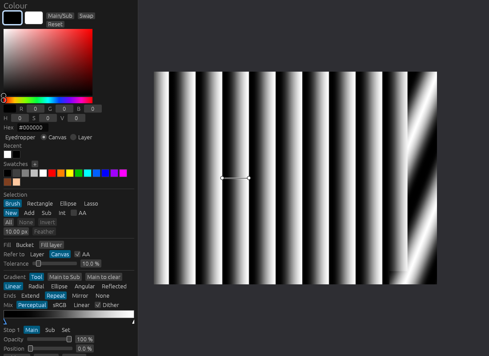 | A repeating gradient while dragging: the right column of tiles still shows the previous gradient (Q-02). |
| 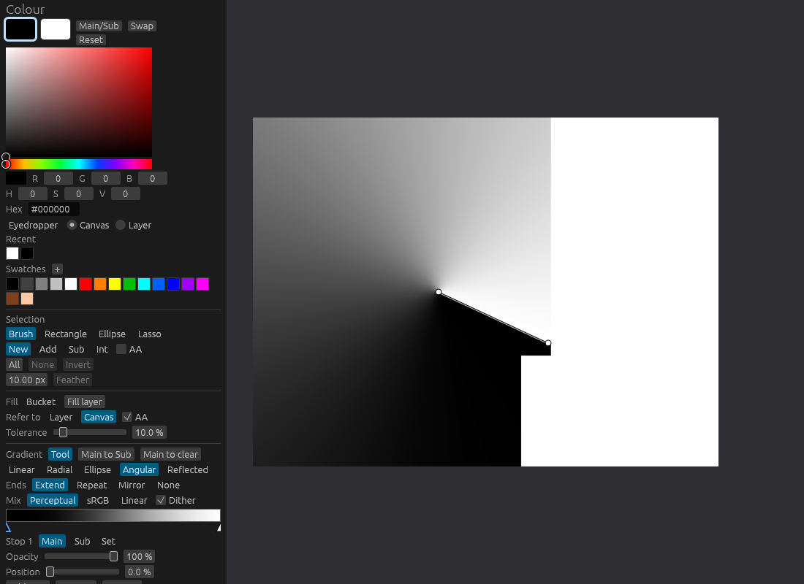 | An angular gradient 400 ms after the pointer stopped: blocks of tiles not yet composed (Q-02). |
| 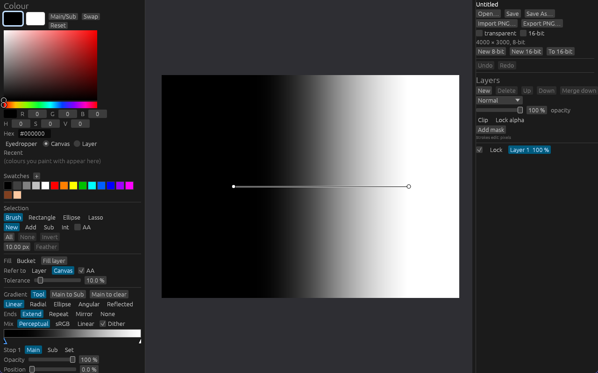 | After the focus was lost mid-drag: a preview and guide on screen, nothing in the document, Undo disabled (Q-03). |
| 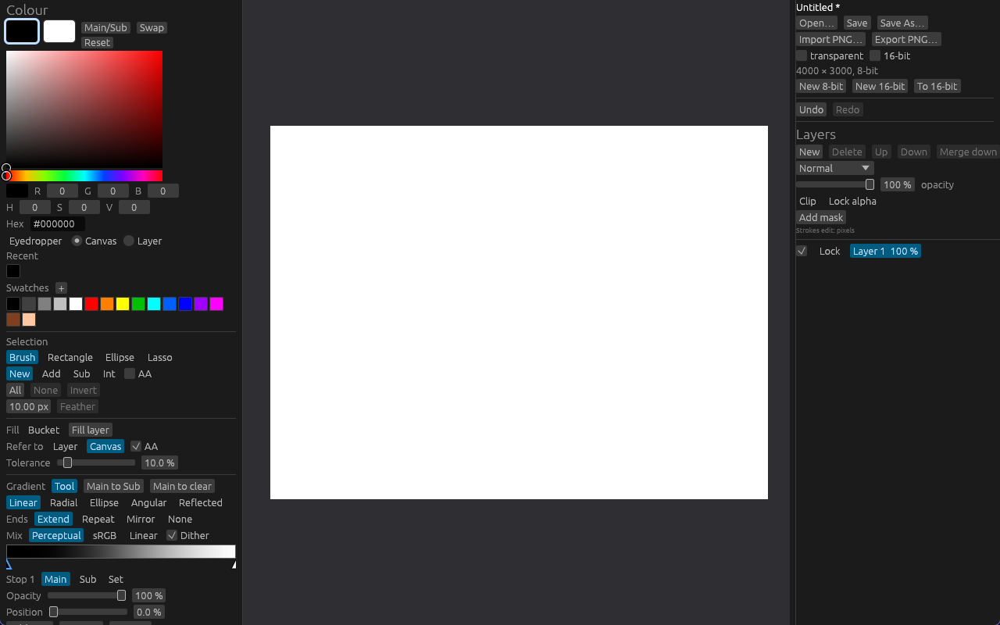 | Two strokes, then E and G and a gradient drag: the strokes are erased, the panel still says "Main to Sub" (Q-05). |

After (this branch, `ui_layout.rs` `audit_screenshots`, the default
1280×800 window unless said):

| | |
|---|---|
| 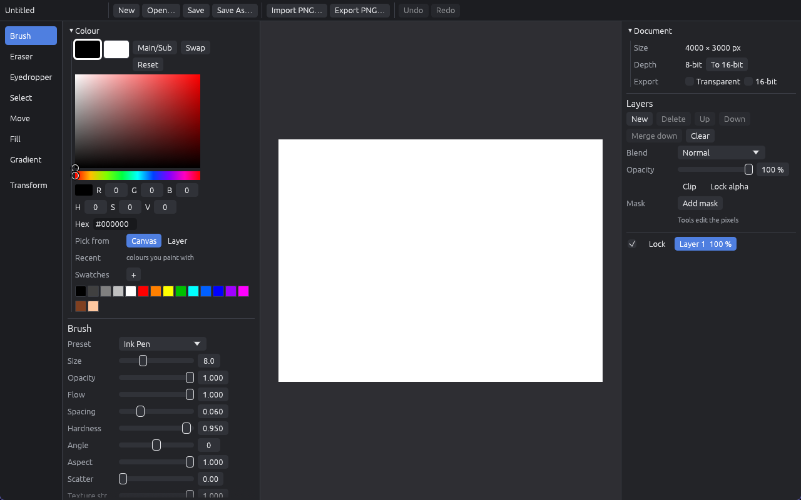 | Brush: the strip, the colour section, the brush's options scrolling. |
| 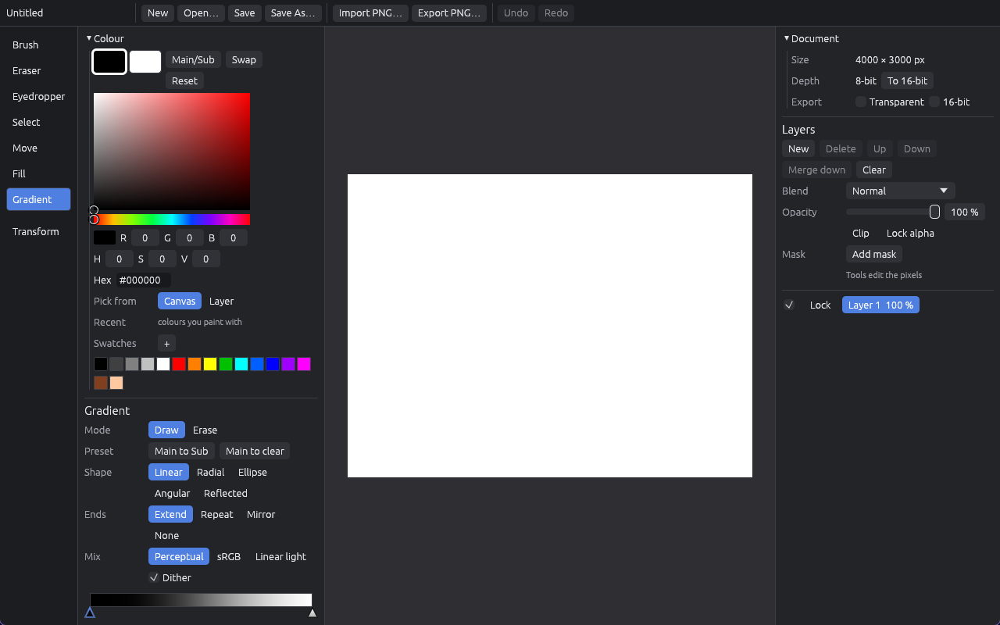 | Gradient options: Mode, Preset, Shape, Ends, Mix, the stop bar and editor. |
| 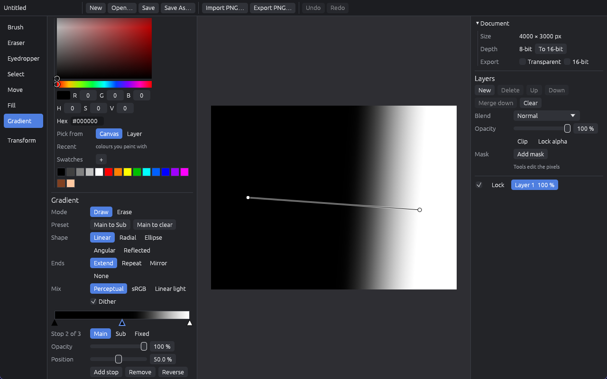 | A gradient preview held mid-drag, three stops. |
| 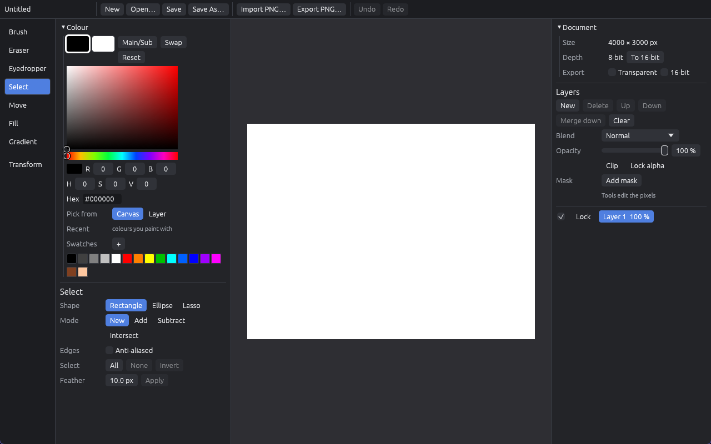 | Selection options. |
| 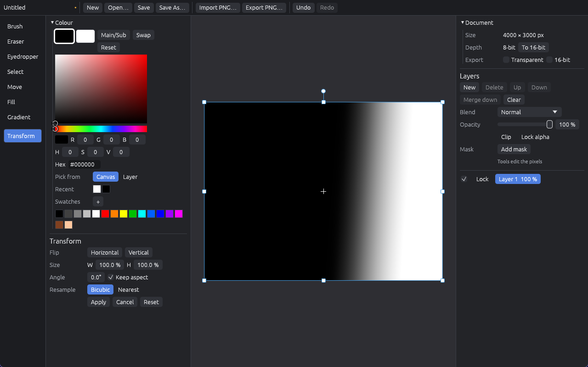 | A transform session's options. |
| 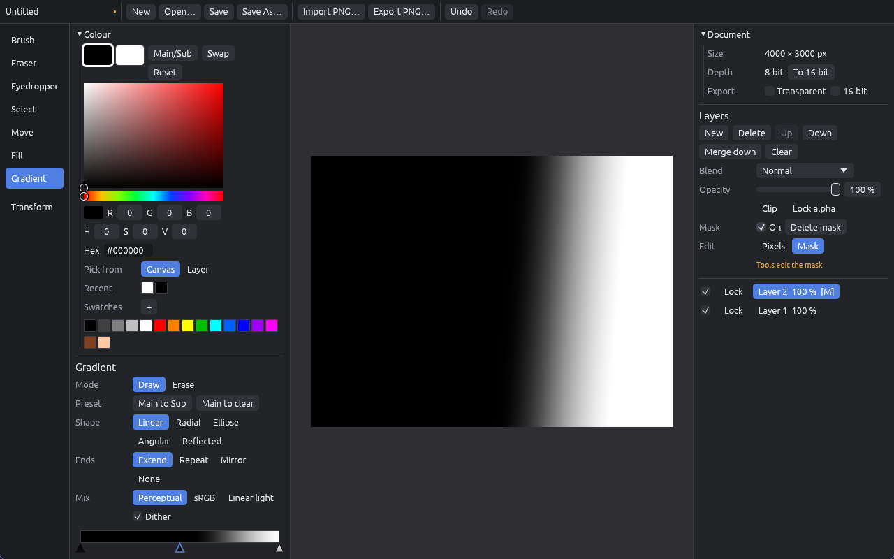 | The mask as edit target: "Mask" selected, an orange "Tools edit the mask". |
| 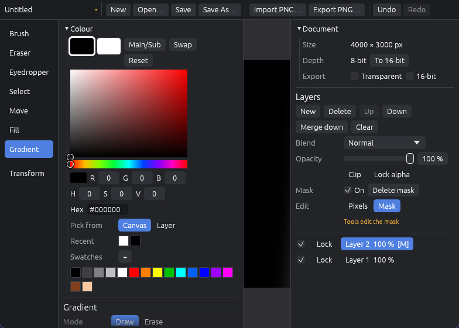 | 800×600. |
| 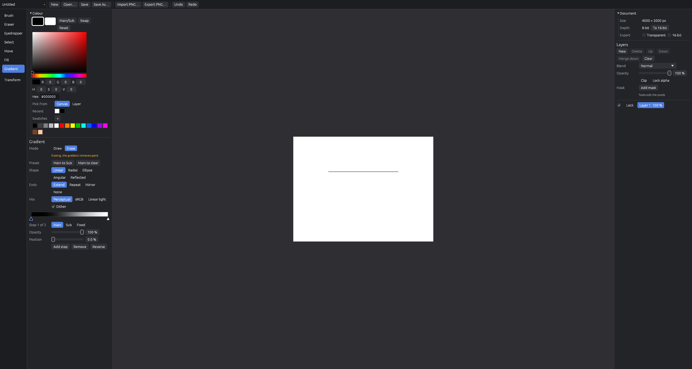 | The gradient's Erase mode, with its warning (maximized). |

The E2E runs keep every capture in `target/e2e/<test>/` with a
`report.md` each.
